# Speech-to-Reasoning Pipeline with Whisper and a Quantized LLM

Name: MUHAMMAD EBADULLAH

A pipeline that takes a spoken question, turns it into text with OpenAI Whisper, and gives the text to a reasoning model that thinks step by step and gives a final answer. Everything runs in one Google Colab notebook on the free T4 GPU.

Notebook: [Speech_to_Reasoning_Whisper_Unsloth.ipynb](Speech_to_Reasoning_Whisper_Unsloth.ipynb)

## Models
| Part | Model |
|---|---|
| Speech recognition | `openai/whisper-small` (fp16) |
| Reasoning | `unsloth/DeepSeek-R1-Distill-Qwen-7B-unsloth-bnb-4bit` (Unsloth dynamic 4-bit) |

DeepSeek-R1-Distill-Qwen-7B is a Qwen model fine-tuned on reasoning examples from DeepSeek-R1. It writes its thinking between `<think>` and `</think>` and then the final answer.

## How the pipeline works
```
audio file --> ffmpeg (16 kHz mono wav) --> 30 s chunks --> Whisper (batched, fp16) --> text
text --> reasoning model (dynamic 4-bit, batched) --> thinking + final answer
```
1. Five spoken questions are created with Google text-to-speech. Four are short and one is a long problem (about 100 words) to test the 30 second chunking. Each has a known answer.
2. Every file is converted with ffmpeg to 16 kHz mono wav and read as a float32 array.
3. Whisper transcribes all the chunks in batches. The texts are joined back for each file, and the transcripts are saved as UTF-8 JSON.
4. Word error rate (WER) compares each transcript with the text that was spoken.
5. Whisper is removed from the GPU, then the reasoning model is loaded.
6. The transcripts go to the reasoning model in one batch (left padding). The output is split at `</think>` into thinking and answer.
7. The answers are checked against the known answers.
8. `speech_to_reasoning(path)` runs the whole pipeline for one audio file. You can upload your own recording in the last section.

## Memory choices
- Whisper runs in fp16 and is freed before the large model is loaded, so the two models are never on the GPU together during the main run.
- The reasoning model is loaded in 4-bit.
- Chunks and questions are processed in batches.
- The notebook prints the GPU memory at every stage.

## How to run
1. Open the notebook in Google Colab (File > Upload notebook, or open it from GitHub).
2. Runtime > Change runtime type > T4 GPU.
3. Runtime > Run all. The first run takes a while because the reasoning model is a download of several GB.
4. To use your own voice, record a question on your phone, set `USE_OWN_AUDIO = True` in Step 12, run the cell and upload the file.

## Results from my run
| Item | Value |
|---|---|
| Whisper model | whisper-small, 242 M parameters |
| Audio files / chunks | 5 files (4 short, 1 of 36.2 sec) / 6 chunks |
| Transcription time | 16.3 sec |
| Average word error rate | 13.9 % |
| Linear layers in 4-bit / kept in higher precision | 149 / 48 |
| Reasoning time (batch of 5) | 48.2 sec, 1,598 tokens |
| Correct final answers | 4 of 5 |
| GPU memory: Whisper loaded / after freeing | 0.48 GB / 0.01 GB |
| GPU memory: reasoning model loaded / peak | 7.91 GB / 8.28 GB of 14.56 GB (56.8 %) |
| End-to-end run, one audio file | 11.8 sec Whisper stage, 12.7 sec reasoning stage, peak 8.72 GB |

Notes on the results:
- Two transcripts were exact. The first and third had a WER of 30.0 % and 26.7 % only because Whisper wrote numbers as digits (60 km, $20) instead of words.
- The long question (36.2 sec) was cut into 2 chunks. Near the cut at 30 seconds, Whisper lost the words "Work out how many" and wrote "any bottles of each kind". The rest was correct.
- The model answered 4 of 5 correctly. For the pharmacy question it answered 45 dollars, but the right answer is 36 dollars (2 large bottles and 1 small bottle). It compared the price per tablet and chose only large bottles without checking a mix.
- All 5 answers finished their thinking (216 to 544 tokens, limit 1,200). The final answers are long formatted solutions with LaTeX and a boxed number.
- In this dynamic 4-bit model, 48 of the 197 linear layers were not quantized, which is one reason it needs about 8 GB.

## Screenshots from my run
**GPU and ffmpeg check**

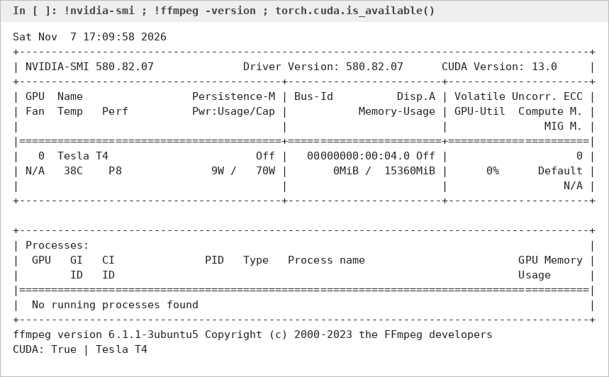

**Sample audio files**

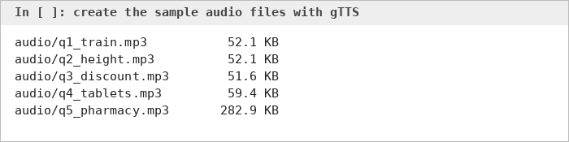

**Audio converted to 16 kHz mono**

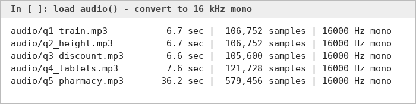

**Whisper loaded**

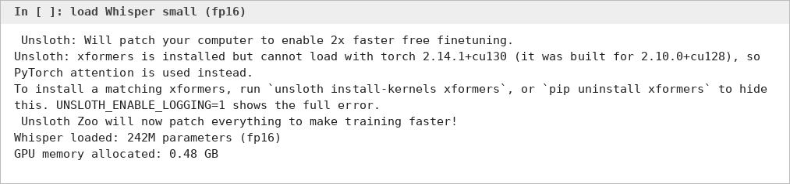

**Transcripts**

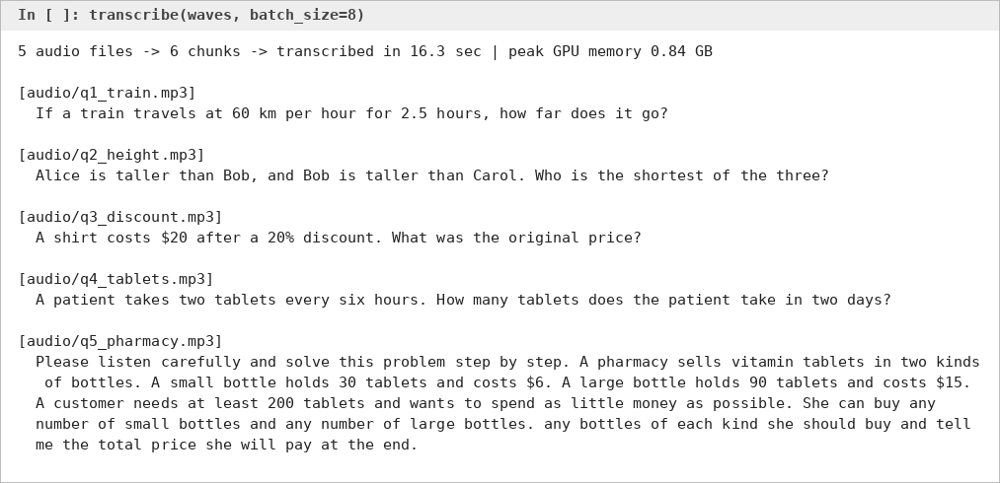

**Word error rate**

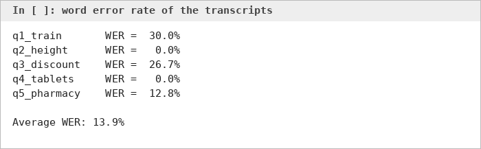

**GPU memory after freeing Whisper**


**Reasoning model loaded**

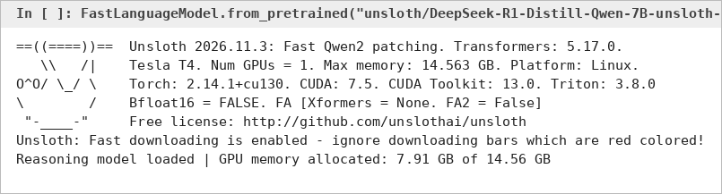

**Quantized and non-quantized layers**

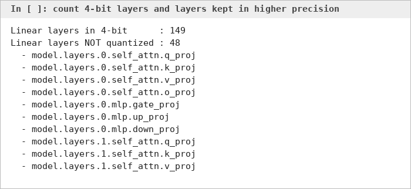

**Thinking and final answers**

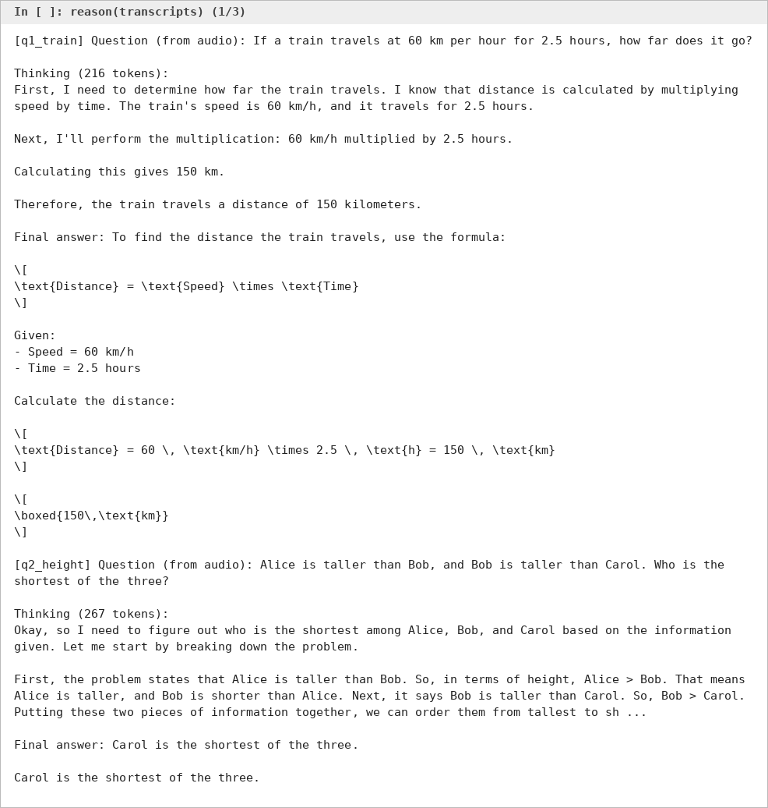

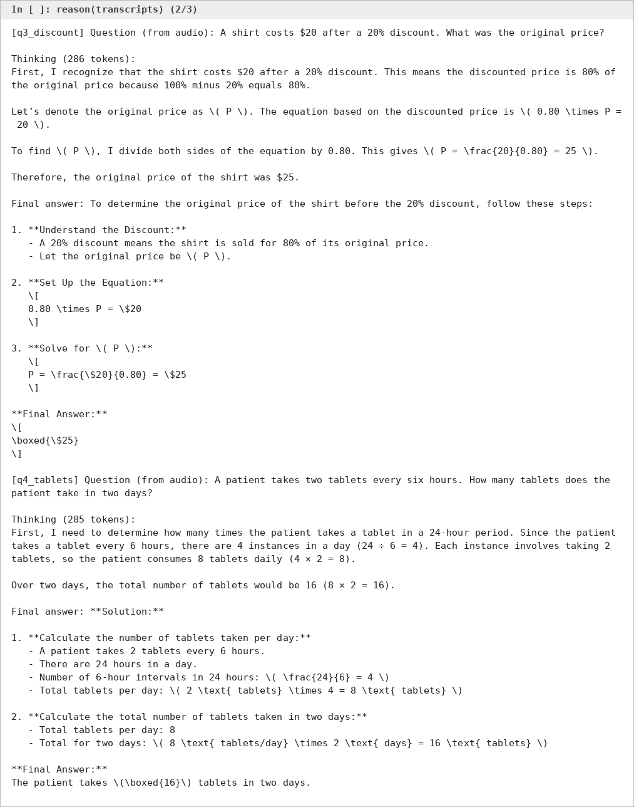

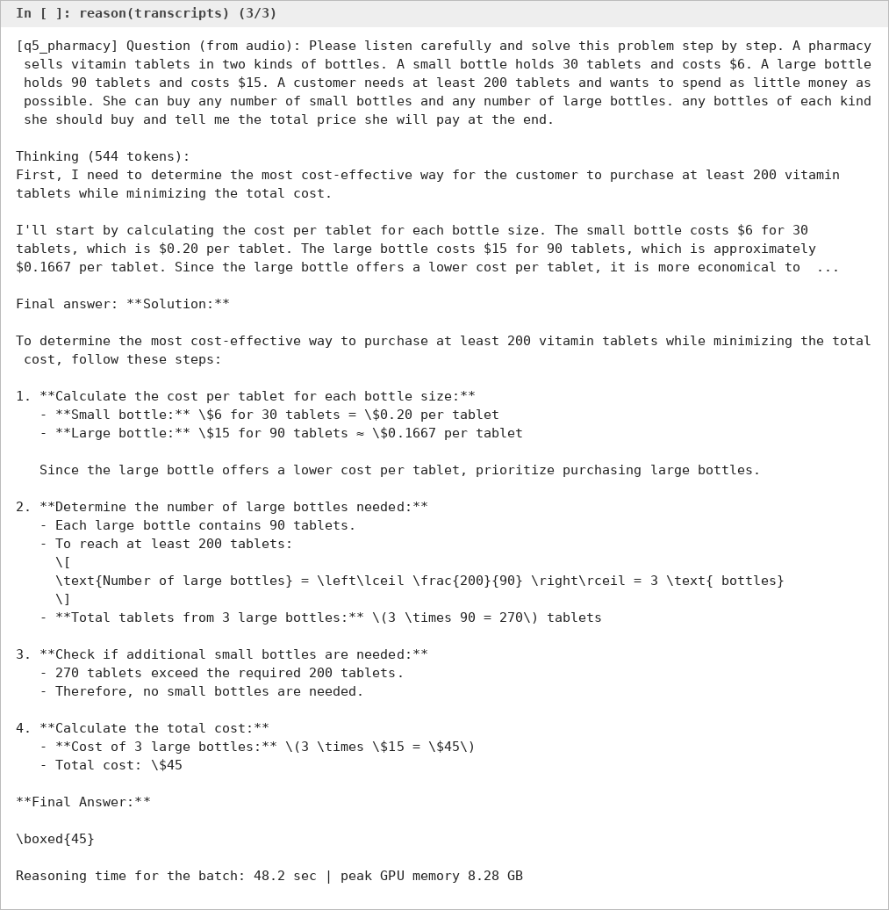

**Answer check**

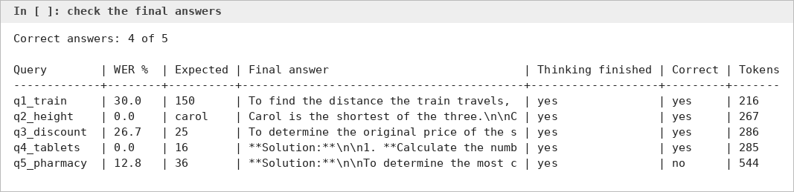

**End-to-end run on one audio file**

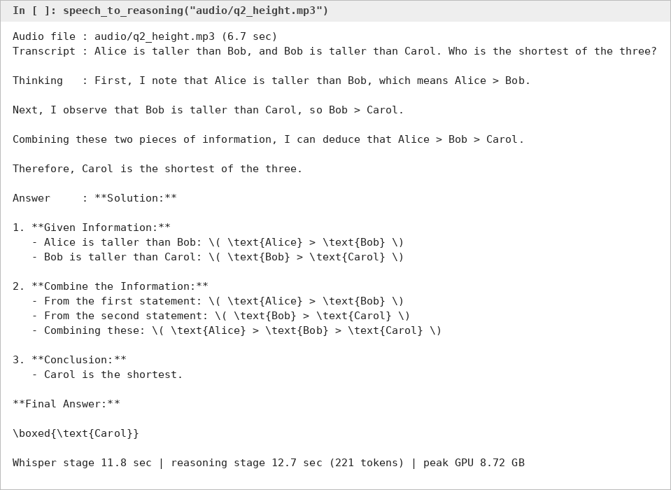

**Memory and time summary**

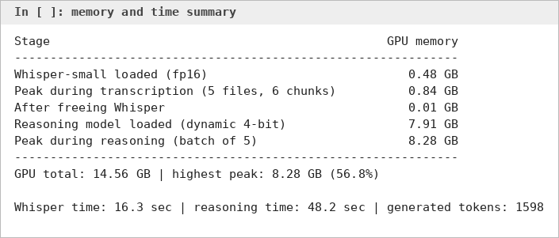

The images above are captures of the output text from the notebook run. The full outputs are in the notebook itself.

## Limitations
- The sample audio is text-to-speech, so it is clean. Real recordings with noise or accents can give more errors.
- Whisper can write numbers as digits (60 instead of sixty), which counts as an error in WER even when the meaning is the same.
- Audio is cut at fixed 30 second points without overlap, so a word at a cut can be misheard. This happened in the long question.
- The reasoning model can run out of tokens before it writes the final answer.
- The reasoning model uses sampling, so the thinking text changes from run to run.
- Only 5 test questions, so the accuracy is a rough number. The answer check is simple text matching (the expected number must appear in the answer).
- The language is set to English.

## Licenses
Whisper is released under the MIT license. DeepSeek-R1-Distill-Qwen-7B is based on Qwen2.5 and is released under an open license (see the model page on Hugging Face).
